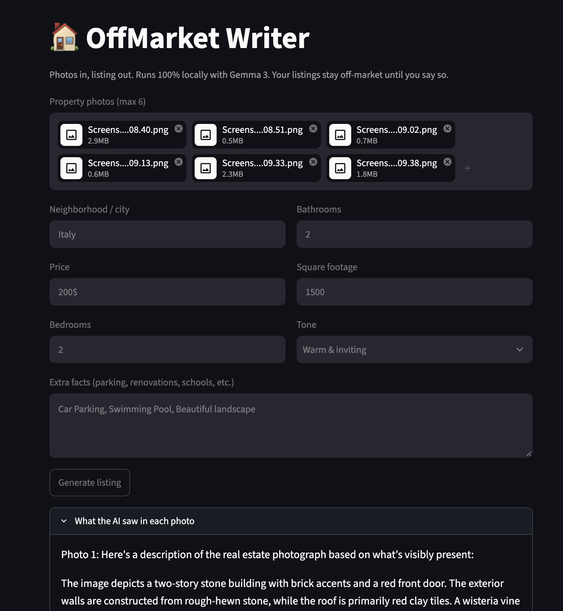

# 🏠 OffMarket Writer

Turn property photos into polished real estate listings, **100% locally**.
Your photos and unlisted property details never leave your laptop.

Built with [Gemma 3](https://ai.google.dev/gemma) (open-weight) running through [Ollama](https://ollama.com) and a Streamlit interface.

## What it does

1. Upload up to 6 property photos
2. Add basic facts (price, beds, baths, location, extras)
3. Pick a tone (warm, luxury, concise, investor-focused)
4. Get a headline, description, and highlights ready to copy

## How it works

Two passes with `gemma3:4b`:

1. **Look:** describes only what is visible in each photo
2. **Write:** combines those notes with the agent's facts into a listing

The prompt forbids inventing features and follows fair housing guidelines.

## Why local?

- Client photos and unlisted properties stay private
- No per-listing API fees
- Open-weight model that can be swapped or fine-tuned

## Setup

1. Install [Ollama](https://ollama.com) and pull the model:
```bash
   ollama pull gemma3:4b
```
2. Install dependencies:
```bash
   pip install -r requirements.txt
```
3. Run the app:
```bash
   streamlit run app.py
```
4. Open http://localhost:8501

## Screenshot



## License

MIT